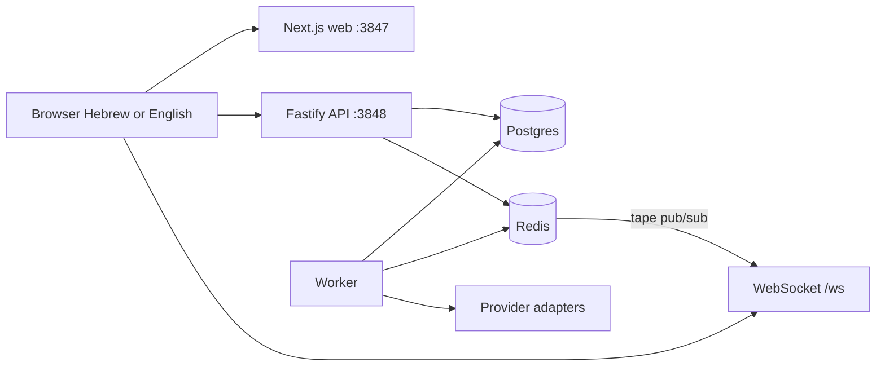

# AlphaTape / אלפאטייפ

סורק מניות חמות לארה״ב ולתל אביב. הציון, היעדים והמחירים מוצגים רק עם מקור וחותמת זמן. בלי מפתחות API המערכת רצה על נתוני הדגמה סינתטיים ומסומנים. זה אינו ייעוץ השקעות.

Hot-stock scanner for US listings and the Tel Aviv Stock Exchange. Every price, rating, target, and fundamental is shown with a source and an as-of time, or as N/A. With no provider keys the app runs on clearly labeled synthetic demo data. This is not investment advice.

## עברית

### מה רץ בלי מפתחות

`docker compose up --build` מעלה Postgres, Redis, API, worker וממשק. בלי מפתחות:

- באנר צהוב: נתוני הדגמה
- 30 מניות חמות, כולל TEVA, NICE, CHKP, MNDY, CYBR, ESLT, WIX, NVMI, CAMT ו-TEVA.TA
- לשונית «השקעה ארוכת טווח»: 15 ניירות שעברו מסך מחושב (10 שנות דיבידנד רצופות, ותשואת מחיר של 5% לפחות ב-5 וב-10 שנים). צמיחה בעבר אינה ערובה
- מחיר, גרף, RSI, MACD וממוצעים נגזרים מסדרת הדגמה. פונדמנטליים סינתטיים מסומנים `demo`
- ציון AI עם פירוק משקלות. זה הערכת מודל, לא ערובה
- וובסוקט מזיז את המחיר בצעדי סימולציה (`demo-simulator`)
- חשבון הדגמה: `adi@demo.local` / `DemoPass123!`

ממשק ברירת המחדל הוא עברית מימין לשמאל. מתג EN בשורת הכותרת.

### הרצה

```bash
cp .env.example .env
docker compose up --build
```

הדפדפן עובד גם ב-[http://localhost:3847](http://localhost:3847) וגם ב-[http://127.0.0.1:3847](http://127.0.0.1:3847).  
API: [http://localhost:3848/health](http://localhost:3848/health) או [http://127.0.0.1:3848/health](http://127.0.0.1:3848/health).

פיתוח מקומי, רק בסיס הנתונים בדוקר:

```bash
docker compose up postgres redis -d
npm install
npx prisma migrate deploy --schema packages/db/prisma/schema.prisma
npm run db:seed
npm run dev
```

בדיקות:

```bash
npm test
```

### מסכים

סורק (30), השקעה ארוכת טווח (15), כרטיס מניה, מפת חום, מובילים, השוואה (2–4), מעקב, התראות, משקלות, מתודולוגיה, כניסה והרשמה.

## English

### Architecture



The score is computed in `packages/shared` from stored inputs. Missing inputs are dropped and the remaining weights are renormalized. They are not treated as zero. A stored number with no provenance is withheld and shown as N/A.

The web UI is served at both [http://localhost:3847](http://localhost:3847) and [http://127.0.0.1:3847](http://127.0.0.1:3847). The API health check is [http://localhost:3848/health](http://localhost:3848/health) or [http://127.0.0.1:3848/health](http://127.0.0.1:3848/health). Dev mode allows both hosts so the page hydrates and the browser calls the API on the same hostname.

### Render

`Dockerfile.render` (context: repository root) runs the production web server, API, websocket, and worker behind one port (`$PORT`). `GET /health` is on that port. Leave `NEXT_PUBLIC_API_URL` and `NEXT_PUBLIC_WS_URL` unset so the browser uses the public origin (`https` and `wss`). Required env: `DATABASE_URL`, `JWT_SECRET`, `NODE_ENV=production`. `REDIS_URL` is optional; without it the cache is skipped and live ticks stay in-process. `render.yaml` is the matching blueprint. On boot the container applies migrations and the idempotent demo seed.

`DATA_MODE=auto` (default): demo random-walk while no quote provider is configured; live refresh when any quote key is set. Live refresh replaces demo figures. Fields the provider does not return stay null.

### Providers

See [docs/PROVIDERS.md](docs/PROVIDERS.md). Keys and signup links are in [.env.example](.env.example). Seeking Alpha, TipRanks, and MarketWatch are disabled stubs. Nothing is scraped.

| Key | What it unlocks |
| --- | --- |
| None | Synthetic demo tape, labeled |
| `POLYGON_API_KEY` | US quotes and daily bars. No TASE |
| `FINNHUB_API_KEY` | Quotes, recommendations, targets, insiders, news. Partial `.TA` |
| `FMP_API_KEY` | Fundamentals, grades, targets, insider stats. Partial `.TA` |
| `TWELVE_DATA_API_KEY` | Quotes, bars, RSI/MACD/SMA, TASE via `exchange=TASE` |
| `ALPHAVANTAGE_API_KEY` | Fallback quotes and bars. About 25 requests/day |
| `YAHOO_UNOFFICIAL_ENABLED=true` | Unofficial `yahoo-finance2` fallback, including `.TA` |
| `OPENAI_API_KEY` | Cached per-stock note and optional theme tags. Off without a key |
| `SMTP_*` | Email on alerts. In-app and websocket alerts work without it |

### Layout

- `apps/web` — Next.js UI, TanStack Table, lightweight-charts, TradingView widgets
- `apps/api` — REST, JWT cookie, Redis cache, Prometheus `/metrics`
- `apps/worker` — demo ticks or live refresh, alert checks
- `packages/shared` — score, indicators, breakout, themes, demo generator
- `packages/providers` — adapters, retry, circuit breaker, rate limits
- `packages/db` — Prisma schema, migration, seed

API examples: [docs/API.md](docs/API.md).

### Tests

`npm test` covers the scoring formula (missing data is excluded, not zeroed), indicator math, breakout rules, the demo generator (price matches the bar series, news is prefixed `[DEMO]`), provider parsers, the circuit breaker, and the rule that TASE symbols are not sent to Polygon.

### Limits

- Demo prices are a seeded synthetic series plus a small random walk. They are not quotes.
- TradingView widgets are a third-party embed and are labeled as such.
- Yahoo data is unofficial and off by default.
- TipRanks, Seeking Alpha, and MarketWatch are not implemented.
- TASE coverage on Finnhub, FMP, and Alpha Vantage is best-effort.
- AI text is generated only from the JSON payload and is still a model estimate.
- Alerts email only when SMTP is set. There is no broker connection and no order entry.
